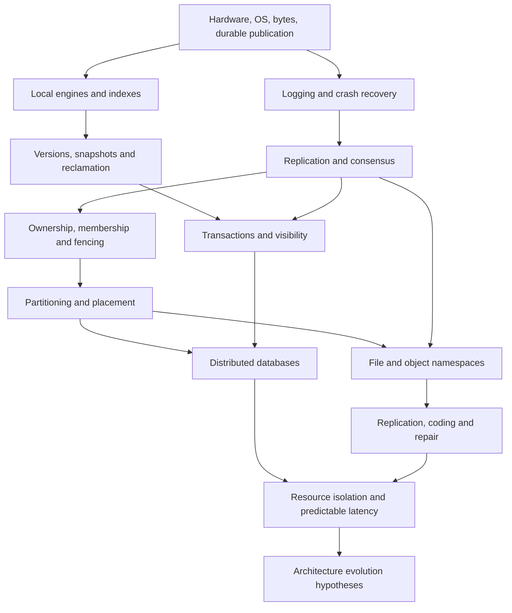

# How the systems compose

[Contents](README.md)

These projects occupy different layers. This map separates conceptual prerequisites from actual implementation dependencies. A conceptual arrow means “learn this to understand that”; it does not mean that the destination imports the source repository.

## The learning dependency graph

## The local project landscape

| Project | Architectural role | Main thing to learn | What is layered above it |
|---|---|---|---|
| [RocksLab](systems/rockslab-week1.md) | Educational LSM simulation | Newest version wins, merging, tombstones | A learning progression to production engines |
| [LevelDB](systems/leveldb.md) | Embedded ordered engine | WAL, memtable, SST, manifest, compaction | An application supplying replication/transactions as needed |
| [RocksDB](systems/rocksdb.md) | Configurable embedded engine | LSM resource management and production tradeoffs | TiKV local KV paths; Ceph BlueStore metadata paths |
| [LMDB](systems/lmdb.md) | Embedded transactional engine | Mapped pages, copy on write, one writer, reader epochs | Application-owned data models and coordination |
| [Redis](systems/redis.md) | Networked data structure server | Encodings, command execution, persistence and replication | Caches, application state, streams, specialized indexes |
| [Paxos](systems/paxos.md) | Small consensus library | Ballots, promises, acceptance and learner state | Application state machine and durable integration |
| [Cornerstone](systems/cornerstone.md) | Raft library | Terms, append, commit, snapshots and pluggable persistence | Application state machine and production integrations |
| [etcd](systems/etcd.md) | Replicated coordination KV | Raft plus MVCC, revisions, watches and leases | Coordination and configuration services |
| [TiKV](systems/tikv.md) | Distributed transactional KV | Regions, Raft, timestamps, MVCC and transactions | TiDB or another transactional client/layer |
| [FoundationDB](systems/foundationdb.md) | Distributed transactional ordered KV | Conflict checking and disaggregated transaction roles | Data model layers and application indexes |
| [OceanBase](systems/oceanbase.md) | Distributed SQL database | SQL, tenants, tablets, log streams and transaction coordination | SQL applications and analytical workloads |
| [Ceph](systems/ceph.md) | Distributed object substrate with block/file/object interfaces | CRUSH, PGs, OSDs, local storage and repair | RBD, CephFS and RGW |
| [CubeFS](systems/cubefs.md) | Distributed filesystem and object/blob paths | Master, namespace partitions, extents and replica/EC blob storage | Filesystem clients and object interfaces |
| [SeaweedFS](systems/seaweedfs.md) | Blob volumes plus namespace/gateways | Needles, volume placement, filer metadata and coding | File, S3 and table/catalog interfaces |

This table summarizes the cited dossiers; it is not a claim that every optional backend or commercial feature is present or enabled. TiDB and PD, for example, are external components discussed to explain TiKV, not additional checkouts discovered under `tpt`.

## Actual composition examples

**TiKV and RocksDB:** a local sorted engine can persist versions for many replicated key ranges. Region Raft establishes replicated ordering; the transactional layer coordinates across keys and ranges. RocksDB cannot supply that distributed correctness by itself. TiKV also has configurable engine variants, so follow the engine selection in the dossier rather than treating one historical layout as universal.

**Ceph and RocksDB:** BlueStore uses a key-value engine for metadata while managing object data and device allocation through its own design. “Ceph uses RocksDB” does not mean every object is one RocksDB value or that RocksDB handles Ceph placement and replication.

**SeaweedFS and embedded/distributed metadata stores:** filer metadata is a separate abstraction with backend choices. Volume-server blob layout is a different path. Selecting a strong metadata backend does not, by itself, make payload replication, gateway semantics and every multi-step write one transaction.

**FoundationDB and local engines:** storage servers materialize committed versions in local engines, but transaction ordering and conflict checking involve separate roles. Replacing a local engine changes local costs; it does not replace the cluster commit protocol.

**etcd and its backend:** a persistent MVCC backend stores applied state, while Raft and WAL logic govern replicated progress. Database compaction, Raft-log compaction and backend defragmentation have different meanings.

## A common architectural interview

For any system, answer these ten questions before claiming architectural understanding:

1. What exact operation does the client issue, and what does success promise?
2. How is a name/key resolved to an owner and to physical bytes?
3. What is the atomicity unit? What extra mechanism spans units?
4. Which state is authoritative after a crash, and how is it published durably?
5. How does a read establish its version and freshness?
6. How is an old owner prevented from committing conflicting work?
7. When can old versions, log segments and physical chunks be reclaimed?
8. What happens during movement, membership change and repair?
9. Which resource limits sustainable throughput and tail latency?
10. Which cost pressure would justify moving a boundary between components?

A diagram without these answers is a component inventory. An architecture explains their interactions and invariants.
