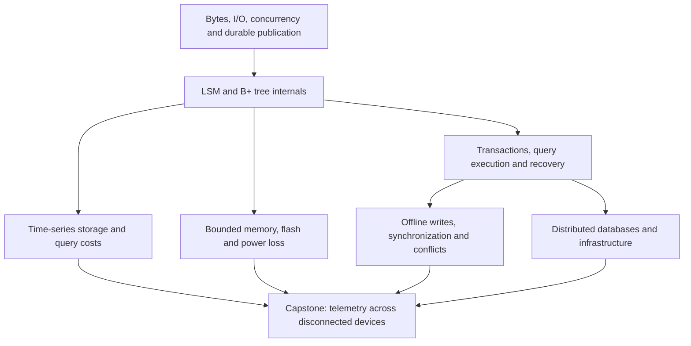

# Expertise path for engines, databases, time series and disconnected systems

[Knowledge base](../README.md) · [Existing architecture sequence](../learning-path.md)

The target is research-level architectural leadership: create and defend new designs, produce credible papers, and influence how systems are built. The [research and leadership program](research-program.md) extends this path with theory, paper critique, reproduction, original work and production judgment. The [research method](research-method.md) and [paper study sequence](paper-study.md) define the evidence required.

The practical foundation is to explain an implementation, preserve its invariants while changing it, measure its costs, and reason about unfamiliar workloads and failures. Make **storage-engine internals the core**, then specialize in **time-series systems** and **resource-constrained or intermittently connected systems**. Distributed databases and large-scale infrastructure remain essential context for how engines are composed and operated.

This ordering is a curriculum proposal based on your stated interests. Your available study time and existing implementation experience are not yet established, so progress is defined by demonstrated competencies rather than a calendar promise. No new source repositories have been installed or cloned, and the labs below are specifications, not completed implementations.

## The competency map

## Priority and mastery gates

| Order | Competency | Main local anchors | Required evidence of understanding |
|---|---|---|---|
| 1 | Machine and engine foundations | RocksLab, LevelDB, LMDB | Trace bytes, versions, ownership and crash publication through one write/read/delete |
| 2 | Engine implementation depth | LevelDB, RocksDB, LMDB | Implement isolated educational LSM and COW-tree exercises; explain every retained byte and recovery decision |
| 3 | Database correctness | FoundationDB, TiKV, OceanBase, etcd | Demonstrate transaction anomalies, index atomicity, commit uncertainty and recovery timelines |
| 4 | Time-series specialization | Engine foundations plus external Prometheus/Gorilla readings | Design keys, postings, chunks, lateness, retention and query budgets; test cardinality growth |
| 5 | Constrained and disconnected specialization | LMDB/LevelDB contrasts plus external SQLite/littlefs/Automerge readings | Bound resources; survive modeled power loss; reconcile duplicate, reordered and delayed data |
| 6 | Large-scale infrastructure | Ceph, CubeFS, SeaweedFS; distributed database roles | Model placement, repair, maintenance debt, tenant isolation and scale-out under failure |
| 7 | Architectural judgment | All of the above | Defend a design against counterexamples and update forecasts when measurements disagree |

Read the [engine depth track](engine-internals.md), [time-series track](time-series.md), [constrained/offline track](constrained-and-disconnected.md), and [lab portfolio](labs.md). The existing [performance/failure chapter](../performance-and-failure-reasoning.md) supplies a common measurement method.

## Study as an engineering loop

Use the [implementation workbook](implementation-workbook.md) as the practical spine: small mechanisms, targeted counterexamples, measurable costs and production-source comparisons. The first exercise extends the existing RocksLab with explainable lookup; later steps add durable logs, tables, snapshots, COW pages, transactions, time-series layout, synchronization and repair.

For each topic, predict the behavior, read the relevant code, draw an operation/failure timeline, implement or instrument a small isolated example, then compare the result with the prediction. Explain the discrepancy before moving on. Preserve a short artifact containing the invariant, exact revision/options, experiment, result and remaining doubt.

Choose one implementation language you can debug comfortably. Follow C++ in LevelDB/RocksDB, C in LMDB, and the other projects' languages as needed; reading every codebase does not require rewriting every exercise in its language. Do not turn language learning into a prerequisite for all storage learning.

## Depth before breadth

Use the full 14-project catalog as a reference map. Spend the first substantial implementation effort on LevelDB and LMDB, then use RocksDB to understand the production costs and concurrency mechanisms absent from a toy engine. Progress to TiKV/FoundationDB after you can distinguish local engine publication from distributed commit.

Time-series and offline requirements should challenge the same engine knowledge rather than become disconnected survey courses. High series cardinality tests metadata budgets; late data tests ordering; limited flash tests write amplification; long outages test retention, reconciliation and deletion safety.

## A useful readiness rubric

- **Explain:** trace the real code path and state the assumptions.
- **Predict:** identify the likely resource or correctness failure before running an experiment.
- **Demonstrate:** reproduce it in an isolated test with a trustworthy oracle.
- **Improve:** change one mechanism while preserving crash/recovery and visibility contracts.
- **Generalize:** explain when the improvement loses to an alternative.

Expertise requires repeated performance and correctness evidence on unfamiliar cases. Finishing a reading list alone does not satisfy these gates. Production operations and fault injection remain subject to the environment's authorization and workflows.

## First milestone

Write a two-page comparison of LevelDB and LMDB for a small telemetry device: exact write acknowledgment, cold read path, update cost, old-reader retention, power-loss recovery and bounded-space behavior. Use the source anchors already in their dossiers. End with a workload where each design is disadvantaged, then choose the first engine lab based on the gap you found.

## Beyond implementation expertise

After the initial milestones, progress through [derive, build, reproduce, characterize, contribute, architect and communicate](research-program.md). Broad architectural fluency remains the goal across all the subjects; the first original contribution should address one narrow, important question. No course completion, artifact or paper acceptance alone establishes industry leadership.
