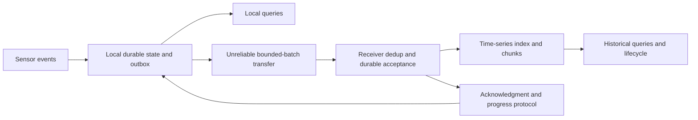

# Lab portfolio and telemetry capstone

[Expertise path](README.md)

These are staged specifications for future isolated learning work. No lab has been implemented, benchmarked or executed as part of this update. Use new learning directories; preserve the source checkouts and the existing RocksLab exercise. Define a contract and oracle before writing implementation code.

For the incremental path inside these larger projects, use the [implementation workbook](implementation-workbook.md). Its first exercise is deliberately small and its later steps expose each mechanism before composing a complete system.

## Lab 1 A small durable LSM

**Build:** append/recovery log, ordered memory state, immutable sorted files, file-set publication, Get/scan, overwrite/delete, one snapshot model and compaction. Start with one writer and a simple format; add concurrency only after the durable path is understandable.

**Required histories:** overwrite then old-snapshot read; deletion with an older value in a different file; interrupted log tail; new SST before manifest publication; crash after sync before reply; crash during recovery; no space for compaction output.

**Evidence:** reference-model comparisons, recovery-state matrix, measured bytes written per user byte, peak space, memory and time spent stalled. A process kill alone proves only the modeled crash class.

**Pass condition:** every tested durable acknowledgment survives the declared failure model, every recovered view is allowed by the contract, and retained records have an explicit reason.

## Lab 2 A persistent COW B+ tree

**Build:** fixed-format pages, search/cursor, split, deletion/rebalance policy, root publication and a reader epoch/free-page model. Simplicity is preferable to incomplete generality.

**Required histories:** root split; leaf split while an old reader is paused; deletion with active readers; crash before/after root publication; interrupted metadata write; reuse after reader completion.

**Evidence:** page reachability checker, ordered-map oracle, page allocation/reuse accounting, and a comparison against Lab 1 on the same logical workload and persistence assumptions.

**Pass condition:** no active root reaches a freed/reused incompatible page; old readers retain the correct view; the cost comparison explains both winners and losers.

## Lab 3 An indexed transactional record layer

**Build:** records plus two secondary indexes over an existing local transactional substrate or your educational engine with an explicitly limited transaction model. Keep index mutations atomic with record changes. Specify what concurrent writers can assume.

**Required histories:** failed update after one index mutation; two competing read-modify-writes; range predicate conflict; write-skew example; unknown commit reply and retry.

**Evidence:** invariant checker and recorded interleavings; distinguish what the substrate guarantees from what the application adds.

**Pass condition:** the implementation satisfies its stated isolation contract and never silently claims stronger isolation than it supplies.

## Lab 4 A small time-series store

**Build:** series registry, timestamp/value chunks, label selection index, bounded mutable state, immutable time partitions, lateness/dedup policy, range queries, retention and one well-specified aggregate.

**Required workloads:** fixed sample rate with increasing cardinality; high series churn; random-value versus compressible-value data; late conflicting sample; deletion/retention while a query is active; broad aggregation competing with ingestion.

**Evidence:** sample correctness oracle, query results, ingest goodput, query p99, peak memory, compression ratio by input class, write bytes and compaction backlog.

**Pass condition:** sample identity and late-data rules produce deterministic documented answers, and performance explanations account for index and metadata costs.

## Lab 5 A bounded disconnected client

**Build:** durable local measurements/outbox, stable event identities, bounded batches, retry, atomic receiver dedup/effect, persisted acknowledgment progress, backoff and a full-buffer policy. Use a deterministic simulated network before real deployment.

**Required faults:** drop, duplicate, reorder and delay batches/replies; crash either endpoint; reset clock; lose connectivity beyond the supported outage; reconnect after tombstone/history expiry; send an old schema or revoked identity.

**Evidence:** state-machine histories, accepted-event oracle, backlog/space/energy assumptions, dedup retention bounds and forced-resync behavior. Count retries without counting their effects twice.

**Pass condition:** the bounded-loss or lossless promise is satisfied within the declared envelope; beyond that envelope the system follows an explicit policy rather than silently discarding or duplicating data.

## Capstone Telemetry across disconnected devices

Combine Labs 4 and 5 with the engine lessons. Devices sample data and serve a small local view. A central service accepts replay, indexes historical data and answers temporal queries. Device configuration is a separate mutable-data path with an explicit authority/conflict model; do not force append-only and collaborative-edit semantics into one mechanism.

**Design review:** specify local versus remote acknowledgment, outage capacity, catch-up rate, correction policy, deletion/rejoin, index atomicity, schema evolution, credentials and restore. Use a small simulated deployment first. Large-scale behavior should initially be a resource model, not a claim established by a few local processes.

**Adversarial review:** ask a reviewer to choose crash points and interleavings you did not design around. Retain failing seeds and minimized histories. Measure normal operation, failure, recovery and catch-up with the same durability contract.

**Final evidence pack:** architecture diagram; invariants; source/options; fault model; correctness results; resource accounting; performance distributions; known limits; one rejected alternative; and one forecast with a falsifier.

## Assessment rule

Advance when the evidence supports the pass condition and you can explain failures without reading the implementation aloud. If an outcome is unclear, narrow the model or improve the observation before adding features. No fixed number of weeks guarantees expertise.
