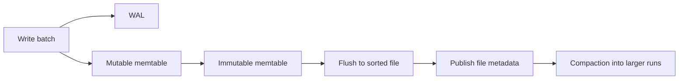

# Local storage engines and reclamation

[Contents](../README.md) · Previous: [Machines and durability](01-machine-and-durability.md) · Next: [Distribution](03-distribution-and-transactions.md)

The engine controls the trade between mutation cost, lookup cost, scans, memory, and reclamation. Understand three families before reading distributed wrappers: log structured merge trees, copy on write trees, and memory oriented data structures.

## 1. Ordered keys are a shared substrate

A comparator defines order. Prefixes can represent tables, tenants, indexes or object metadata. Encoding must preserve the ordering the application expects: naive variable-length numeric text sorts `10` before `2`. Range scans, partition boundaries and conflict ranges all inherit the encoding's decisions. Index entries consume storage and introduce extra writes; they are not free views.

A batch groups local mutations atomically where supported. It does not automatically give read-modify-write isolation or cross-node transactions. A snapshot gives a stable read view; it does not alone prevent two writers from making conflicting decisions.

## 2. The LSM write path

Conceptual path:

The arrows show dependencies and lifecycle, not the exact synchronization order for every engine. The durable acknowledgment point depends on options and code.

The **memtable** keeps recent versions in a structure supporting lookup and often ordered traversal. A **flush** materializes an immutable sorted table. A **compaction** merges existing sorted runs, reduces overlap and may reclaim obsolete versions. They are separate operations. The WAL permits recovery before a memtable reaches an SST.

Read [LevelDB file organization](/Users/bmysoren/tpt/leveldb/doc/impl.md:11), then its [table format](/Users/bmysoren/tpt/leveldb/doc/table_format.md:1). Use [rockslab](../systems/rockslab-week1.md) to practice the merge model, then [LevelDB](../systems/leveldb.md), then [RocksDB](../systems/rocksdb.md). The lab's in-memory model does not demonstrate power-loss durability.

## 3. The LSM read path

A point lookup checks the relevant memory state and candidate files, respecting version order. SST indexes select blocks; filters can rule out absent keys; caches can avoid device reads. Lower levels may have nonoverlapping key ranges, while overlapping young files can increase lookup work. Scans merge iterators over multiple sorted sources and discard versions outside the requested snapshot.

A Bloom filter answers “definitely absent” or “possibly present.” False positives cause extra work. It does not find the value, eliminate all I/O, or fix cache pollution. A block cache usually stores decoded or compressed blocks according to engine configuration; the OS page cache serves a different layer. Double caching and per-shard cache duplication can matter.

## 4. Amplification is a budget

Define the measurement boundary before comparing numbers:

- **Write amplification:** physical bytes written divided by logical user bytes written. Decide whether WAL, compaction, replication and device-internal writes are included.
- **Read amplification:** extra bytes, files, blocks or operations required per logical read. State which quantity you measure.
- **Space amplification:** allocated physical storage divided by live logical data, with retained snapshots, redundant copies, and free-space reserves named explicitly.

Illustrative calculation, not a benchmark: a logical stream of 100 MB/s with engine write amplification 8 requires about 800 MB/s of engine device writes before additional overhead. Three replicated copies would consume about 2.4 GB/s across replica devices if each independently incurs that amplification. Actual log/application coupling can change the accounting; do not multiply unrelated ratios blindly.

Leveled compaction generally buys lower space and lookup overhead with more rewriting. Tiered/universal policies can reduce rewriting while retaining more runs and temporary space. The [RocksDB compaction documentation](https://github.com/facebook/rocksdb/wiki/Compaction) explains the policy families. No policy dominates all workloads.

## 5. MVCC and tombstones

Represent versions conceptually as `(user key, version, kind, value)`. A reader at version 8 must still see version 7 even if a writer has installed version 9. A deletion marker hides older values; removing it prematurely can resurrect them.

A compactor must reason about both retained read versions and the possibility of older values outside its current inputs. LevelDB documents [deletion-marker elimination](/Users/bmysoren/tpt/leveldb/doc/impl.md:104); consult the implementation for snapshot rules. Distributed GC adds another boundary: a replica that missed deletion must not reintroduce stale data.

**Logical deletion**, **physical reclamation**, **returning filesystem space**, and **secure erasure from every replica and backup** are distinct outcomes.

## 6. Copy on write trees and LMDB

A B+ tree stores ordered keys in pages and traverses internal pages to leaves. With copy on write, an update replaces affected pages and publishes a new root; existing read transactions keep seeing older pages. Compared with an LSM, this moves work toward changed tree paths and page management rather than merging sorted runs.

LMDB maps its file into virtual memory and returns references whose lifetime is bounded by the transaction. “Zero copy” does not mean zero device I/O: an access can page fault. It also does not mean the data can be retained after the transaction closes. See [LMDB value lifetime](/Users/bmysoren/tpt/lmdb/libraries/liblmdb/intro.doc:62).

LMDB permits many concurrent readers and one writer. Long-lived readers preserve old state and can delay reuse, so a nominally read-only client can cause file growth. See [transaction lifetime and writer serialization](/Users/bmysoren/tpt/lmdb/libraries/liblmdb/intro.doc:128). A key learning exercise is comparing this reclamation boundary with an LSM's oldest snapshot.

## 7. Redis and memory oriented structures

Redis serves typed operations over in-memory structures. Hash tables optimize lookup; ordered structures support ranking/range behavior; compact encodings reduce overhead for small objects; persistence and replication are additional mechanisms. A data structure's representation can change with size and configuration.

RDB snapshots, AOF logging, and replica acknowledgments solve different problems. An event loop that executes commands serially does not eliminate background work, network concurrency, persistence costs, or multi-node races. Read [Redis](../systems/redis.md) before transferring its command-level behavior to a distributed transaction claim.

## 8. Background work is part of the foreground design

Flush, compaction, garbage collection, expiry, snapshotting and repair compete with user work for CPU, memory, storage and network. If the rate of debt creation exceeds service capacity, queues grow until admission control or failure intervenes. A burst test may measure borrowed capacity rather than sustainable throughput.

A useful model is `change in backlog = incoming maintenance work − completed maintenance work`. It explains why tail latency may rise long after a burst ends. Adding worker threads helps only while the bottleneck resource and scheduling permit it.

## Check your understanding

Trace `put(k, v1)`, snapshot, `put(k, v2)`, `delete(k)`, flush and compaction. State what the old snapshot sees and which physical records must remain. Then explain why the same workload causes different background work in LMDB and RocksDB.
