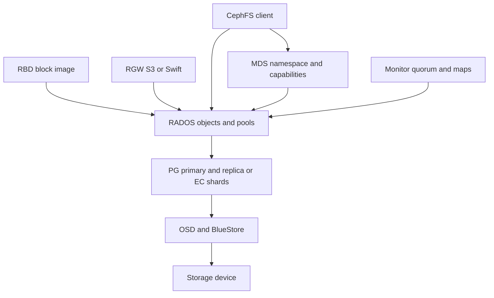

# Ceph: one distributed object substrate, several storage interfaces

[Contents](../README.md) · [Comparisons](../comparison.md) · [Learning path](../learning-path.md)

Local snapshot: `0fab663780ab76bb88aead23d15e930b826151a9` (commit dated 2026-10-27). Read-only source and documentation study; no cluster inspection, builds, or performance measurements. Repository worktree was clean when inspected. No repository-local AGENTS.md was found.

## Build the mental model from the bottom up

1. **Device and local transaction engine.** An OSD controls local storage; the default backend is BlueStore. BlueStore must make both object bytes and the metadata that finds those bytes recoverable. Its documented small-write strategies distinguish writing a new blob and committing metadata from logging overwrite intent before deferred overwrites. The document contains explicitly prospective modes, so it is an explanation of tradeoffs rather than proof every described strategy is active today. [OSD/object storage](/Users/bmysoren/tpt/ceph/doc/architecture/storage-cluster.rst:51), [BlueStore write strategies](/Users/bmysoren/tpt/ceph/doc/dev/bluestore.rst:9).
2. **RADOS object.** Identifier, binary contents, attributes; a RADOS object is the unit exposed by the common substrate. A user-visible S3 object, file, or block image need not map one-to-one to it. [Object structure](/Users/bmysoren/tpt/ceph/doc/architecture/storage-cluster.rst:68), [S3 mapping distinction](/Users/bmysoren/tpt/ceph/doc/architecture/ceph-clients.rst:66).
3. **Pool and placement group (PG).** A pool supplies placement/redundancy policy; each object maps to a PG and each PG belongs to one pool. PGs aggregate placement, ordering, recovery state, and accounting. [Pool/PG relationship](/Users/bmysoren/tpt/ceph/doc/rados/operations/placement-groups.rst:14).
4. **Placement computation.** The cluster map plus CRUSH lets clients and OSDs compute placement instead of consulting a per-object location directory. The CRUSH hierarchy expresses failure domains such as device, host, and rack. [Placement](/Users/bmysoren/tpt/ceph/doc/architecture/scalability-high-availability.rst:31), [Failure-domain map](/Users/bmysoren/tpt/ceph/doc/architecture/scalability-high-availability.rst:71).
5. **Primary-led replication or EC.** A PG primary orders mutations and coordinates replicas/shards. PG history includes map epoch and increasing per-PG version; recent logs make recovery more targeted than copying everything. [Ordering and log](/Users/bmysoren/tpt/ceph/doc/dev/osd_internals/log_based_pg.rst:20).
6. **Interfaces built above RADOS.** RBD stripes an image over objects; RGW implements S3/Swift and its own metadata formats; CephFS adds filesystem namespace and coordination through MDS. These share storage infrastructure, not identical API contracts. [Interfaces](/Users/bmysoren/tpt/ceph/doc/architecture/ceph-clients.rst:12), [RBD layout](/Users/bmysoren/tpt/ceph/doc/architecture/ceph-clients.rst:83).

## Separate the planes

| Plane | Main responsibility | Scaling consequence |
| --- | --- | --- |
| Control | Monitors maintain authoritative maps; manager hosts monitoring/orchestration modules | Monitor consensus governs cluster membership and map changes, not each object payload |
| Data | Clients communicate with OSDs; PG primaries order mutations; backend stores bytes | Shards distribute work, but a single hot object/PG retains coordination constraints |
| Namespace metadata | MDS for CephFS; RGW metadata/index formats for object semantics; RBD image metadata | Metadata scaling must be studied per interface, independently of raw OSD throughput |

The daemon roles and map responsibilities are documented explicitly. Monitor agreement uses Paxos with a majority, while MDS journals are stored in RADOS and can be replayed by standbys. Multiple active MDS ranks partition the namespace. [Daemon roles](/Users/bmysoren/tpt/ceph/doc/architecture/storage-cluster.rst:19), [Monitor quorum](/Users/bmysoren/tpt/ceph/doc/architecture/scalability-high-availability.rst:102), [MDS failover and scaling](/Users/bmysoren/tpt/ceph/doc/architecture/ceph-clients.rst:138).

## Trace the important paths

**Write:** frontend translates its operation into RADOS operations → client uses maps/placement to contact the responsible OSD → primary orders the PG mutation → replicated backend constructs local transaction, sends peers their operations, and waits for commit callbacks → upper layers finish the operation. In the inspected replicated backend, `waiting_for_commit` is initialized from the acting/recovery/backfill shard set; a local ObjectStore commit callback is registered; completion occurs when the waiting set empties. This is stronger evidence than a loose statement that Ceph writes to a majority. [Transaction submission](/Users/bmysoren/tpt/ceph/src/osd/ReplicatedBackend.cc:638), [Local commit callback](/Users/bmysoren/tpt/ceph/src/osd/ReplicatedBackend.cc:668), [Completion](/Users/bmysoren/tpt/ceph/src/osd/ReplicatedBackend.cc:696).

**Acknowledgment nuance:** `PrimaryLogPG` distinguishes applied progress from `all_committed`, and committed callbacks execute only after the latter. Pool `size` describes the desired replica count; `min_size` is a threshold for accepting I/O while degraded, not a universal substitute for the healthy write protocol. Application acknowledgment can occur earlier if a frontend or client has a writeback cache; application flush/fsync behavior needs its own trace. Hardware durability still depends on honest flush behavior and deployment configuration. [Commit gate](/Users/bmysoren/tpt/ceph/src/osd/PrimaryLogPG.cc:11666), [Committed callbacks](/Users/bmysoren/tpt/ceph/src/osd/PrimaryLogPG.cc:11698), [Pool degraded-I/O threshold](/Users/bmysoren/tpt/ceph/doc/rados/operations/pools.rst:748).

**Read:** translate frontend offset/key → locate object/PG → read through a suitable OSD path. The traditional documented replicated path can read from the primary; EC can need remote shard reads and reconstruction. Do not turn that into an assertion that every present-day configuration prohibits replica reads. [Read-path distinction](/Users/bmysoren/tpt/ceph/doc/dev/osd_internals/log_based_pg.rst:140).

**Recovery:** map changes alter the relevant interval and acting set → peering compares prior histories → a valid authoritative history is selected → missing/stale objects are repaired or backfilled. EC needs special treatment of unstable writes because one shard is insufficient to reconstruct a version; rollback of incomplete updates prevents incompatible mixtures of versions. Recovery and foreground operations also need shared locking/scheduling. [Peering/log argument](/Users/bmysoren/tpt/ceph/doc/dev/osd_internals/log_based_pg.rst:43), [EC rollback reason](/Users/bmysoren/tpt/ceph/doc/dev/osd_internals/log_based_pg.rst:58), [Recovery reservations](/Users/bmysoren/tpt/ceph/doc/dev/osd_internals/recovery_reservation.rst:13).

**Delete:** a RADOS delete is classified as a write and passes into `_delete_oid`; replication and transactional consistency still apply. File unlink, S3 version/delete-marker behavior, snapshots, and eventual physical reclamation are higher-level concerns; this study has not proven a single common reclamation timeline across them. [Delete opcode](/Users/bmysoren/tpt/ceph/src/osd/PrimaryLogPG.cc:7204).

## Failure domains and likely bottlenecks

Facts: CRUSH expresses placement across failure domains; monitor availability requires quorum; replication/EC and pool minimum sizes constrain continued I/O. A correct replica count alone does not prove rack/zone survival: placement rules and correlated failures matter.

Reasoned performance hypotheses, not measured findings:

- Random small writes amplify metadata/checksum/read-modify-write work in BlueStore; device IOPS alone is an incomplete sizing metric.
- PG count trades distribution granularity against memory and scheduling overhead; a hot object remains hot even when total cluster capacity expands.
- EC degraded reads consume reconstruction CPU and extra network/disk reads; repair competes with foreground traffic.
- RGW bucket indexes and CephFS namespace hot spots can limit an application even when the underlying RADOS pool has spare bandwidth.
- Map churn and peering create availability/tail-latency effects distinct from steady-state throughput.

## Code study route

Read the linked pool/map/object documentation first, then follow `ReplicatedBackend::submit_transaction` → `op_commit` and `PrimaryLogPG::repop_all_committed` → `eval_repop`. Contrast the EC history argument before studying EC implementation. Finally select one interface: RBD image striping, RGW bucket indexes, or CephFS MDS journaling/capabilities. The RGW index document is a separate route, not proof that RGW semantics were audited here. [RGW index entry point](/Users/bmysoren/tpt/ceph/doc/dev/radosgw/bucket_index.rst:1).

## Evolution: local signals, predictions, and tests

**Observed signal:** Crimson is an alternate OSD build, explicitly not enabled by default; SeaStore targets NVMe, user-space I/O, Seastar futures, sharded processing, and minimal copying. These are documented goals and available source paths, not evidence of universal production readiness. [Crimson build status](/Users/bmysoren/tpt/ceph/doc/dev/crimson/index.rst:12), [SeaStore goals](/Users/bmysoren/tpt/ceph/doc/dev/crimson/seastore.rst:10).

**Prediction, medium confidence:** faster devices increase pressure to reduce CPU, locks, copies, and cross-core coordination; reactor/shard-aware OSD and local-engine work should remain important. Counterpressure: preserving recovery correctness, feature completeness, and operability may slow replacement of established paths. Validate by comparing release support matrices, default backend choices, CPU-per-I/O, p99 latency, recovery behavior, and adoption—not repository directory size.

**Prediction, medium confidence:** richer placement and automated PG balancing continue to matter as hardware becomes more heterogeneous. Validate against actual map-policy changes and mixed-media deployments.

**Limits:** historical design documents explicitly warn that some interfaces are outdated. This dossier verifies architecture and selected commit gates, not every modern EC optimization, client caching mode, gateway atomicity rule, or deployed failure policy. No performance or durability SLA is inferred from source alone.
