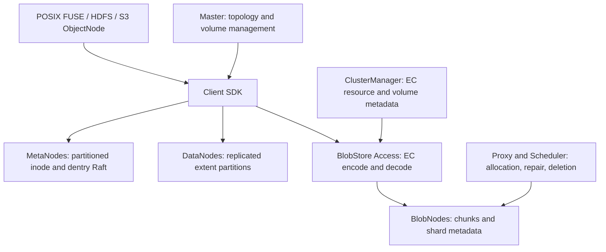

# CubeFS: independent namespace, replica, and erasure-coded storage layers

[Contents](../README.md) · [Comparisons](../comparison.md) · [Learning path](../learning-path.md)

Local snapshot: `ca5609b0af9108ef2eda825827e2f43fba65f596` (commit dated 2026-08-19). Read-only source/document study; repository worktree was clean. No repository-local AGENTS.md found. This describes the checked-out implementation, not a live deployment or latest upstream release.

## Start with the building blocks

| Primitive | Meaning | Why it exists |
| --- | --- | --- |
| Inode | File/directory identity and attributes | Names can change without redefining file identity |
| Dentry | `(parent inode, name)` directory entry | Separates namespace lookup from file content |
| MetaPartition | An inode-ID range with inode and dentry B-trees; replicated Raft group | Shards namespace state and consensus work |
| DataPartition | A group of mirrored data replicas on DataNodes | Unit of replica placement, management, and recovery |
| Extent | Local content container addressed through extent metadata | Separates file offsets from physical storage |
| Filesystem volume | Collection of metadata and data partitions | Mountable namespace; exposed as a bucket in object access |
| BlobStore volume | EC storage allocation assembled from chunks | Different concept from a filesystem volume |
| Blob / shard / chunk | Blob is an EC input unit; shards are encoded pieces; chunks contain those pieces on disks | Separates user payload, coding unit, and physical container |

The metadata structures and volume decomposition are explicit in the local architecture and design documents. [Subsystems](/Users/bmysoren/tpt/cubefs/docs/source/overview/architecture.md:5), [Metadata keys and ranges](/Users/bmysoren/tpt/cubefs/docs/source/design/metanode.md:9), [BlobStore terminology](/Users/bmysoren/tpt/cubefs/docs/source/design/blobstore.md:33).

The replica engine distinguishes **normal extents** for larger files from **tiny extents** that pack small-file content. The document describes normal extents as up to 128 MiB and tiny extents as up to 4 TiB with 4 KiB alignment; treat these as the documented format for this tree, not universal user file-size limits. Tiny-file removal uses hole punching; normal extent files can be deleted. [Extent layouts](/Users/bmysoren/tpt/cubefs/docs/source/design/datanode.md:93), [Small-file packing and deletion](/Users/bmysoren/tpt/cubefs/docs/source/design/datanode.md:21).

## Assemble the architecture

**Control plane:** Master manages volumes, node health, and partition lifecycle; multiple Masters replicate state with Raft and RocksDB. BlobStore has a separate ClusterManager, Proxy, and Scheduler. **Metadata plane:** MetaNodes own the inode/dentry namespace, split into Multi-Raft groups. **Data plane:** DataNodes serve replica extents; Access and BlobNodes serve EC payloads. The object gateway adds S3 access rather than replacing the namespace/data decomposition. [Master and namespace](/Users/bmysoren/tpt/cubefs/docs/source/overview/architecture.md:7), [Replica and EC subsystems](/Users/bmysoren/tpt/cubefs/docs/source/overview/architecture.md:19), [BlobStore modules](/Users/bmysoren/tpt/cubefs/docs/source/design/blobstore.md:25).

## Trace write, read, recovery, and deletion

**Replica write:** client discovers/caches volume topology and namespace/extent information → chooses a DataPartition and writes extent data → records or updates the file-to-extent mapping in metadata. The local API separates writing bytes from appending extent keys, so studying publication and retry boundaries is essential. Sequential writes use primary-backup replication; random overwrites use Multi-Raft. This is not one uniform Raft path for every file write. [Client caches](/Users/bmysoren/tpt/cubefs/docs/source/design/client.md:7), [Replication modes](/Users/bmysoren/tpt/cubefs/docs/source/design/datanode.md:27), [Write API](/Users/bmysoren/tpt/cubefs/sdk/data/stream/extent_client.go:712), [Extent mapping API](/Users/bmysoren/tpt/cubefs/sdk/meta/api.go:1512).

**Read:** resolve inode/dentry and fetch extent keys → map requested file offsets to extents → read DataNodes, or access cached/EC backing content where configured. `ExtentClient.Read` and `ReadExtent` are useful anchors for the concrete selected path. [Read entry point](/Users/bmysoren/tpt/cubefs/sdk/data/stream/extent_client.go:766), [Extent read](/Users/bmysoren/tpt/cubefs/sdk/data/stream/extent_client.go:819).

**EC write:** Access obtains an available BlobStore volume → splits data into blobs → encodes data/parity shards → writes chunks concurrently → returns a location that must remain reachable from higher-level metadata. The source returns when `PutQuorum` succeeds, keeps outstanding shard work alive in the background, and sends repair work for bad indexes. The threshold is code-mode/config dependent; it should not be reduced to “a majority of all shards” or “all shards persisted.” The docs' `>n` language is less precise than the actual configuration and branches. [Documented EC path](/Users/bmysoren/tpt/cubefs/docs/source/design/blobstore.md:65), [Quorum selection](/Users/bmysoren/tpt/cubefs/blobstore/access/stream/stream_put.go:205), [Success/repair behavior](/Users/bmysoren/tpt/cubefs/blobstore/access/stream/stream_put.go:443).

**EC read:** normally fetch the needed ranges; reconstruct when shards are unavailable. LRC can keep some reconstruction within an AZ. Extra read requests can reduce tail latency by accepting the first sufficient responses, trading more work for lower waiting time. [Degraded reads and speculative reads](/Users/bmysoren/tpt/cubefs/docs/source/design/blobstore.md:76), [LRC](/Users/bmysoren/tpt/cubefs/docs/source/design/blobstore.md:115).

**Recovery:** metadata replays logs/snapshots and elects new leaders; clients retry group members after a not-leader result. Replica recovery first reconciles append extents by length, then applies Multi-Raft recovery for overwrite state. BlobStore Scheduler orchestrates repair/migration/disk recovery. These are distinct state machines and failure scopes. [Metadata recovery](/Users/bmysoren/tpt/cubefs/docs/source/design/metanode.md:24), [Client leader refresh](/Users/bmysoren/tpt/cubefs/docs/source/design/client.md:16), [Replica repair sequence](/Users/bmysoren/tpt/cubefs/docs/source/design/datanode.md:39).

**Delete:** namespace unlink and content release are separate operations; normal extents, packed tiny extents, and EC chunks have different reclamation mechanisms. DataPartition directories include normal/tiny deletion records. BlobStore has scheduled deletion/recycling and append-only chunk files, so dead content is not equivalent to immediate physical space return. Complete end-to-end unlink/GC timing was not traced here. [Delete records](/Users/bmysoren/tpt/cubefs/docs/source/design/datanode.md:100), [Append-only chunk engine](/Users/bmysoren/tpt/cubefs/docs/source/design/blobstore.md:135), [Scheduler responsibilities](/Users/bmysoren/tpt/cubefs/docs/source/design/blobstore.md:29).

## Durability and consistency: three separate questions

1. **Did replicas/shards accept the bytes?** Sequential replication and EC `PutQuorum` answer different questions. EC repair can still be outstanding after foreground success.
2. **Did bytes reach a durable local boundary?** Replica packets propagate `IsSync` into the extent store; `Extent.Write` calls `file.Sync()` conditionally. A generic write success must not be equated with a synchronous device flush. The full API-to-packet flag path requires a separate fsync study. [Packet sync flag](/Users/bmysoren/tpt/cubefs/datanode/wrap_operator.go:959), [Conditional local sync](/Users/bmysoren/tpt/cubefs/datanode/storage/extent.go:478).
3. **Can another client observe the correct namespace/mapping?** Strongly replicated metadata does not eliminate client-cache semantics. The client design explicitly cautions against concurrent writing from different mounts and describes forced metadata refresh at open. “Strong metadata consistency” alone is not a promise of arbitrary multiwriter POSIX behavior. [Client consistency caveat](/Users/bmysoren/tpt/cubefs/docs/source/design/client.md:9).

Failure survival depends on which domains contain replica groups and EC shards, metadata quorum placement, the EC code mode, the write-success threshold, and the repair exposure window. The docs support 1/2/3-AZ EC arrangements; that capability alone proves no particular deployment survives an entire AZ loss. The source also has a special degraded multi-AZ success branch that deserves explicit testing in any durability audit. [EC deployment options](/Users/bmysoren/tpt/cubefs/docs/source/design/blobstore.md:13), [Multi-AZ success branch](/Users/bmysoren/tpt/cubefs/blobstore/access/stream/stream_put.go:454).

## Bottlenecks and tradeoffs to test

These are architectural hypotheses, not measured regressions:

- Memory-centric inode/dentry B-trees make metadata footprint, partition skew, and replay time important.
- Random overwrite paths pay consensus costs that append paths can avoid; workload mix changes the bottleneck.
- Data publication and namespace updates cross subsystems; partial failure and retry correctness matter as much as raw bandwidth.
- EC reduces capacity overhead but adds encoding, shard fanout, repair traffic, and degraded-read amplification.
- FUSE small writes and cache coherence can dominate before disks saturate. The local client design explicitly discusses limitations of writeback-cache performance. [FUSE behavior](/Users/bmysoren/tpt/cubefs/docs/source/design/client.md:26).
- Layered caches improve locality but add eviction, warm-up, duplicate storage, and failure semantics that should be measured separately from durable capacity.

## Evolution from locally evidenced signals

**Observed:** the project expanded from replicated storage to BlobStore EC, with cache partitions and client warm-up layering performance over a cheaper durable tier. The tree documents local block cache indexing/LRU and live FUSE client upgrade. [EC motivation](/Users/bmysoren/tpt/cubefs/docs/source/design/blobstore.md:3), [Cache partitions](/Users/bmysoren/tpt/cubefs/docs/source/design/datanode.md:43), [Warm-up and L1 cache](/Users/bmysoren/tpt/cubefs/docs/source/design/client.md:59), [Client upgrade](/Users/bmysoren/tpt/cubefs/docs/source/design/client.md:34).

**Prediction, medium confidence:** more explicit hot/cold policy, cache placement, and EC/locality tuning will matter as datasets grow faster than the affordable replicated tier. Validate through storage-class defaults, cache-hit distributions, repair costs, and lifecycle policy changes.

**Prediction, medium confidence:** client efficiency and online operability will remain major differentiators for AI/data-lake workloads. Counterevidence would be simplification toward gateway-only workloads. The document's future-tense kernel-client statement is historical text, not proof of the current roadmap; the repository already has a separate kernel-client design page. [Kernel-client design entry](/Users/bmysoren/tpt/cubefs/docs/source/design/kernelclient.md:1).

## Guided study and remaining gaps

Study architecture → MetaNode keys/ranges and snapshots → replica extents and the two write protocols → client `Write`/`Read` and extent-key publication → BlobStore terminology/quorum source → repair/delete scheduling. Then trace one real workload's syscall/API acknowledgment through caches, packets, and disk sync.

Not established: exact current cross-partition rename/transaction guarantees; full replica-chain acknowledgment behavior; BlobNode disk-flush policy for every EC mode; S3 versioning/retention interactions; scheduler lag under failure; current upstream roadmap. The source-backed distinctions above prevent treating these unknowns as architectural guarantees.
