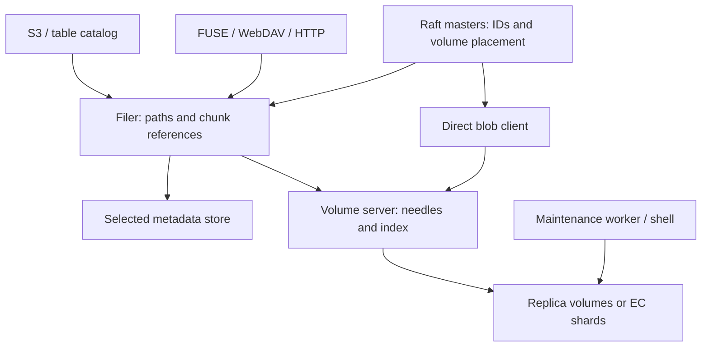

# SeaweedFS: packed blobs first, namespace and protocols above them

[Contents](../README.md) · [Comparisons](../comparison.md) · [Learning path](../learning-path.md)

Local snapshot: `3a0af308ce8d7225ed6b7b75196adf1384dc8b00` (commit dated 2026-10-27). Read-only documentation/source study; worktree was clean. No repository-local AGENTS.md found. Claims describe the local tree; no live service or performance validation occurred.

## Fundamental building blocks

1. **Needle:** an individually addressed blob record packed into a larger data file. The file ID contains volume ID, needle key, and cookie; this distinguishes blob identity from filesystem path. [File ID structure](/Users/bmysoren/tpt/seaweedfs/weed/storage/needle/file_id.go:11).
2. **Volume:** an append-oriented container of many needles with an index mapping keys to positions. This amortizes filesystem inode/metadata overhead across many small objects. The default in-memory index is described as 16 bytes per blob; backend and build choices can alter memory use. [Packed layout](/Users/bmysoren/tpt/seaweedfs/README.md:189), [Volume role](/Users/bmysoren/tpt/seaweedfs/README.md:261).
3. **Volume server:** owns local volumes, serves blob reads/writes, and participates in replica or EC storage. Its storage bytes and index must become durable consistently. [Durable data/index sequence](/Users/bmysoren/tpt/seaweedfs/weed/storage/volume_write.go:209).
4. **Master:** assigns file IDs and tracks volume-to-server placement, rather than a record for every user file. This keeps placement metadata relatively small; clients cache mappings. Master redundancy uses Raft. [Master scaling](/Users/bmysoren/tpt/seaweedfs/README.md:199), [Raft integration](/Users/bmysoren/tpt/seaweedfs/weed/server/master_server.go:301).
5. **Filer:** adds paths, directories, file attributes, and references to chunks. Its persistent metadata store is configurable, so filesystem availability/transaction properties depend partly on the selected store. [Filer and metadata stores](/Users/bmysoren/tpt/seaweedfs/README.md:201).
6. **Gateway/protocol layer:** S3, FUSE, WebDAV, SFTP, and newer table catalogs use the underlying blob/namespace infrastructure. Accessing the same underlying data does not make all protocol semantics identical. [Layering](/Users/bmysoren/tpt/seaweedfs/README.md:260).

## Distinguish the planes

| Plane | Responsibilities | Architectural implication |
| --- | --- | --- |
| Control | Masters, topology, ID assignment, maintenance scheduling | Placement state scales with volumes; control availability still matters for allocation and stale-map refresh |
| Metadata | Filer namespace backed by selected database | A horizontally replicated gateway does not automatically replicate or protect its database |
| Data | Volume servers, needle index, local data files, replicas/EC | Direct blob reads can bypass filer namespace lookup once the caller holds IDs |
| API/semantic | S3, file interfaces, table catalogs | Retention, versions, permissions, and table commits require separate semantic analysis |

The repository says masters are outside the normal read path and that adding a server does not automatically rebalance existing content. Balancing, vacuum, EC conversion, and repair can be initiated through shell/maintenance workers. That is a different capacity-management model from assuming every node addition immediately redistributes old data. [Read path and mapping](/Users/bmysoren/tpt/seaweedfs/README.md:189), [Capacity and maintenance](/Users/bmysoren/tpt/seaweedfs/README.md:199).

## Follow an operation

**Direct blob write:** request assignment/locate an appropriate volume → upload the blob to a volume server → server parses the request into a needle → performs replicated write → return the file ID/result. `PostHandler` waits for `ReplicatedWrite` and reports failure if it returns an error. The replication routine fetches writable peers, runs local persistence and remote fanout concurrently, waits for both, and returns local or remote errors. It propagates `fsync=true` to replicas. [HTTP handler](/Users/bmysoren/tpt/seaweedfs/weed/server/volume_server_handlers_write.go:46), [Replication and sync option](/Users/bmysoren/tpt/seaweedfs/weed/topology/store_replicate.go:33), [Fanout](/Users/bmysoren/tpt/seaweedfs/weed/topology/store_replicate.go:100), [Completion/errors](/Users/bmysoren/tpt/seaweedfs/weed/topology/store_replicate.go:198).

**Filer write:** split/upload content into blob chunks, construct a file entry with chunk references, then publish it via `CreateEntry` in the metadata store. The inspected autochunk path checks for conflicting append/offset updates before publishing and keeps uncommitted-chunk cleanup state until metadata succeeds. This is evidence that payload and namespace publication are distinct failure boundaries; it is not proof of one transaction spanning all storage/database components. [Publication/conflict check](/Users/bmysoren/tpt/seaweedfs/weed/server/filer_server_handlers_write_autochunk.go:511), [Metadata publication](/Users/bmysoren/tpt/seaweedfs/weed/server/filer_server_handlers_write_autochunk.go:530).

**Read:** for direct blob access, file ID gives volume and key → cached volume mapping gives server → needle index supplies local offset → read record/data. For a filer path, first resolve namespace entry/chunk list, then read needed blobs. The README's O(1)/one-seek description concerns blob addressing and ordinary storage access, not a bound on directory lookup, multi-chunk requests, remote tiers, HTTP overhead, or reconstruction under every failure. [Fast-path claims](/Users/bmysoren/tpt/seaweedfs/README.md:189).

**Recovery:** master Raft and volume-server reports rebuild the placement view; lost replicas or EC shards require maintenance repair; filesystem metadata recovery is the selected database's responsibility plus any configured replication/backup. Readable blobs are insufficient if all namespace/chunk references are lost. No universal automatic repair deadline was established here. [Master integration](/Users/bmysoren/tpt/seaweedfs/weed/server/master_server.go:301), [Maintenance responsibilities](/Users/bmysoren/tpt/seaweedfs/README.md:200), [Metadata backup options](/Users/bmysoren/tpt/seaweedfs/README.md:248).

**Delete and reclamation:** remove namespace reachability where applicable → replicate needle deletes → append deletion information/update indexes → later vacuum copies live contents and reclaims dead bytes. Deletion acknowledgment is not the same as space reclamation or an assured synchronous delete flush. The inspected `deleteNeedle2` explicitly sets `fsync := false`. Compaction has separate temporary data/index output files and must distinguish corruption from transient storage errors. [Replicated delete](/Users/bmysoren/tpt/seaweedfs/weed/topology/store_replicate.go:209), [Delete durability caveat](/Users/bmysoren/tpt/seaweedfs/weed/storage/volume_write.go:434), [Vacuum files](/Users/bmysoren/tpt/seaweedfs/weed/storage/volume_vacuum.go:111), [Compaction error treatment](/Users/bmysoren/tpt/seaweedfs/weed/storage/volume_vacuum.go:23).

## Acknowledgment and failure-domain nuance

The inspected normal replicated write is **not evidence that every successful upload was fsynced**. The replication entry point defaults `fsync` to false. With sync enabled, the local path appends bytes, flushes the data backend before publishing its mapping, and flushes the index before completing; the implementation also has a batching path. Replica fanout carries the sync setting. The term `syncWrite` names an execution path and does not by itself mean a durable flush. [Default flag](/Users/bmysoren/tpt/seaweedfs/weed/topology/store_replicate.go:57), [Conditional branch](/Users/bmysoren/tpt/seaweedfs/weed/storage/volume_write.go:194), [Data flush](/Users/bmysoren/tpt/seaweedfs/weed/storage/volume_write.go:209), [Index flush](/Users/bmysoren/tpt/seaweedfs/weed/storage/volume_write.go:240).

Likewise, master Raft consensus is a control-plane property, not proof that each needle write is replicated through Raft. Normal blob data uses the separate fanout path. The implementation checks whether writable locations are fewer than the volume's requested copy count. An error after partial success can leave bytes on some replicas; retry/orphan handling is therefore part of correctness. [Writable-replica check](/Users/bmysoren/tpt/seaweedfs/weed/topology/store_replicate.go:363).

Replication is rack/data-center aware when configured, but actual survival depends on topology labels, copy placement, EC layout, repair latency, metadata database durability, and flush policy together. Cross-cluster asynchronous replication adds a separate lag/RPO dimension. [Topology capabilities](/Users/bmysoren/tpt/seaweedfs/README.md:202), [Cross-cluster replication](/Users/bmysoren/tpt/seaweedfs/README.md:248).

## Bottlenecks and experiments suggested by the design

Architectural hypotheses, not measured results:

- Packed small files reduce filesystem metadata overhead but grow needle-index memory; index backend selection changes that tradeoff.
- Volume-level locks and sync batching can make hot-volume skew important even with ample cluster-wide disks.
- Sync replication exposes tail latency to slow peers; no-sync replication changes crash durability rather than making hardware latency disappear.
- Namespace database latency and contention can cap filer throughput independently of volume-server throughput.
- Vacuum, replica repair, EC conversion, and foreground traffic compete for space, bandwidth, and disk time. Free-space headroom matters during rewriting.
- Cold-data EC reduces storage overhead but adds conversion/reconstruction and maintenance complexity; cloud tiering trades local capacity for remote latency/API cost.

Test small objects versus large chunked files, sync flag on/off, healthy versus missing replica/shard, single hot volume versus broad distribution, database latency injection, and steady-state traffic during vacuum/repair. Report application acknowledgment, metadata publication, physical flush, and completed redundancy as separate milestones.

## Evolution: distinguish observation from prediction

**Observed local signals:** the tree contains a Rust volume-server implementation that states binary/protocol compatibility with the Go master and existing `.dat/.idx/.vif` storage. The README also describes integrated Iceberg/Lance catalogs and table maintenance. These are concrete implementation/documentation signals; their benchmark superiority and compatibility completeness were not validated here. [Rust implementation contract](/Users/bmysoren/tpt/seaweedfs/seaweed-volume/README.md:1), [Catalog direction](/Users/bmysoren/tpt/seaweedfs/README.md:224).

**Prediction, medium confidence:** the project will continue moving from a compact blob substrate toward an integrated S3/data-lake platform while keeping the packed-volume abstraction. More API semantics increase metadata coordination, authorization, and lifecycle complexity above an otherwise simple byte store. Validate against catalog transaction tests, interoperability results, and operational separation of components.

**Prediction, medium confidence:** Rust/Go data-plane parity, safer durable batching, and maintenance automation will remain important as performance and correctness demands grow. Counterpressure is the cost of keeping on-disk/protocol behavior and failure semantics aligned across implementations. Validate with crash/replay tests and feature parity, not language choice alone.

## Guided study and limits

Read file IDs and volume layout → `PostHandler` → `ReplicatedWrite` → `Volume.syncWrite`/index publication → delete/vacuum → filer autochunk metadata commit → selected metadata-store transaction implementation → selected protocol semantics. Compare Go and Rust failure handling only after the Go baseline is understood.

Not established: exact guarantees of every metadata-store backend, full POSIX multiwriter behavior, every S3 retention/versioning flow, detailed EC stripe/repair policy, master reconciliation under all split-brain cases, or performance under repair pressure. Local README scalability and comparative claims are treated as design descriptions, not independent measurements or guarantees.
